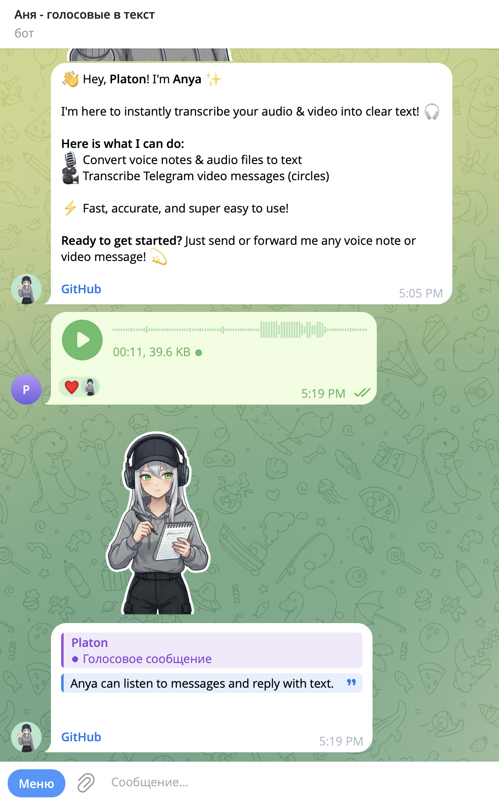
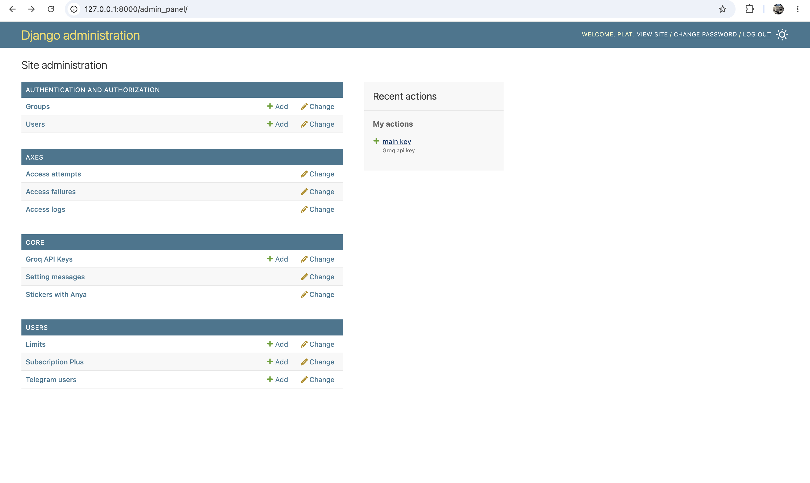

# Anya-Voice-to-Text

Telegram bot: send a voice or a video note → get text.

This guide shows how to run the bot and the Django admin on a Linux server.

☕ Make a cup of coffee. It takes about 15–20 minutes.

---

## ✨ Features

- Voice -> text
- Video notes (circles) → text
- Limits + Plus (Telegram Stars)
- Django admin (texts, stickers, Groq keys)

---

## 📸 Screenshots

<table>
  <tr>
    <td></td>
    <td></td>
  </tr>
  <tr>
    <td align="center"><b>Greeting</b></td>
    <td align="center"><b>Voice → text</b></td>
  </tr>
</table>

---

## What you need

- Linux server (Ubuntu 20.04+, Debian 11+, or similar)
- SSH access
- Python 3
- Git
- A free [Groq API](https://console.groq.com) key (for voice recognition)

---

## 1. Connect to the server

```bash
ssh username@your_server_ip
```

Change `username` and `your_server_ip` to your data.

---

## 2. Install packages

```bash
sudo apt update && sudo apt upgrade -y
sudo apt install -y python3 python3-venv python3-pip git
```

### Cloudflared (HTTPS for admin)

**Normal VPS (amd64):**

```bash
wget https://github.com/cloudflare/cloudflared/releases/latest/download/cloudflared-linux-amd64.deb -O cloudflared.deb
sudo dpkg -i cloudflared.deb
```

**Raspberry Pi 5 (arm64):**

```bash
wget https://github.com/cloudflare/cloudflared/releases/latest/download/cloudflared-linux-arm64.deb -O cloudflared.deb
sudo dpkg -i cloudflared.deb
```

Check path:

```bash
which cloudflared
```

---

## 3. Download the project

```bash
cd /home/your_username
git clone https://github.com/platilich/Anya-Voice-to-Text.git
cd Anya-Voice-to-Text
```

Show full path (save it):

```bash
pwd
```

---

## 4. Virtual environment

```bash
python3 -m venv venv
source venv/bin/activate
pip install -r requirements.txt
```

Every time you open a new terminal:

```bash
source venv/bin/activate
```

---

## 5. Create `.env`

Get bot token: [@BotFather](https://t.me/BotFather)

Create secret key:

```bash
openssl rand -base64 32
```

Create file:

```bash
nano .env
```

Paste:

```env
TOKEN=your_telegram_bot_token_here
DEBUG=False
SECRET_KEY=paste_openssl_key_here
ALLOWED_HOSTS=*
```

Save: `Ctrl + X` → `Y` → `Enter`.

---

## 6. Database + CSS (do not skip!)

**Order matters.** First create tables, then apply them, then collect CSS.

Without this step the bot often crashes and the admin looks broken (no style).

```bash
source venv/bin/activate
python manage.py makemigrations
python manage.py migrate
python manage.py collectstatic --noinput
```

Create admin user:

```bash
python manage.py createsuperuser
```

Type username, email (can skip), password.

---

## 7. Admin panel — first steps



### What you do here

1. Open admin in the browser (see Step 8 for the link)
2. Log in with the user from Step 6
3. Open **Groq API Keys**
4. Add at least one key from [console.groq.com](https://console.groq.com)
5. Save

! Without a Groq key, voice recognition will not work.

You can also edit texts and stickers in admin later.

---

## 8. Systemd (auto start)

You need 3 services: bot, Django, Cloudflared.

```bash
whoami
pwd
which cloudflared
```

### Bot

```bash
sudo nano /etc/systemd/system/anya-voice-to-text.service
```

```ini
[Unit]
Description=Anya-Voice-to-Text bot
After=network.target

[Service]
Type=simple
User=your_username
WorkingDirectory=/home/your_username/Anya-Voice-to-Text
EnvironmentFile=/home/your_username/Anya-Voice-to-Text/.env
ExecStart=/home/your_username/Anya-Voice-to-Text/venv/bin/python bot/main.py
Restart=always
RestartSec=5

[Install]
WantedBy=multi-user.target
```

### Django

```bash
sudo nano /etc/systemd/system/anya-django.service
```

```ini
[Unit]
Description=Anya Django admin
After=network.target

[Service]
Type=simple
User=your_username
WorkingDirectory=/home/your_username/Anya-Voice-to-Text
EnvironmentFile=/home/your_username/Anya-Voice-to-Text/.env
ExecStart=/home/your_username/Anya-Voice-to-Text/venv/bin/python manage.py runserver 127.0.0.1:8000
Restart=always
RestartSec=5

[Install]
WantedBy=multi-user.target
```

### Cloudflared

```bash
sudo nano /etc/systemd/system/cloudflared.service
```

Use path from `which cloudflared`:

```ini
[Unit]
Description=Cloudflared tunnel
After=network.target anya-django.service

[Service]
Type=simple
User=your_username
ExecStart=/usr/bin/cloudflared tunnel --url http://127.0.0.1:8000
Restart=on-failure
RestartSec=5

[Install]
WantedBy=multi-user.target
```

### Start all

```bash
sudo systemctl daemon-reload
sudo systemctl enable anya-voice-to-text anya-django cloudflared
sudo systemctl start anya-voice-to-text anya-django cloudflared
```

Check:

```bash
sudo systemctl status anya-voice-to-text
sudo systemctl status anya-django
sudo systemctl status cloudflared
```

You want: `active (running)`.

### Find admin link

```bash
sudo journalctl -u cloudflared -n 50 --no-pager
```

Look for `https://....trycloudflare.com`  
Then open: `https://....trycloudflare.com/admin/`

---

## 9. django-axes (login protection)

`axes` blocks people who try many wrong passwords on `/admin/`.

- Use a strong password
- If you get locked: wait a bit, or check logs

---

## Useful commands

```bash
# bot logs
sudo journalctl -u anya-voice-to-text -f

# django logs
sudo journalctl -u anya-django -f

# admin URL
sudo journalctl -u cloudflared -n 50 --no-pager

# restart all
sudo systemctl restart anya-voice-to-text anya-django cloudflared
```

---

## If something breaks

| Problem | Fix |
|--------|-----|
| Bot crashes | Run again: `makemigrations` → `migrate` → check `TOKEN` in `.env` |
| Admin has no CSS | `python manage.py collectstatic --noinput` |
| Voice does not work | Add Groq key in admin |
| No admin URL | `sudo journalctl -u cloudflared -n 50 --no-pager` |
| Service down | `sudo systemctl status name-of-service` |

Always turn on venv first:

```bash
source venv/bin/activate
python manage.py makemigrations
python manage.py migrate
python manage.py collectstatic --noinput
```

---

## 🔒 Security

- `DEBUG=False` on the server
- Do not put `.env` on GitHub
- trycloudflare link is public — share only with people you trust

---

If this project helps you, a ⭐ on GitHub is appreciated.

© 2026 Anya-Voice-to-Text